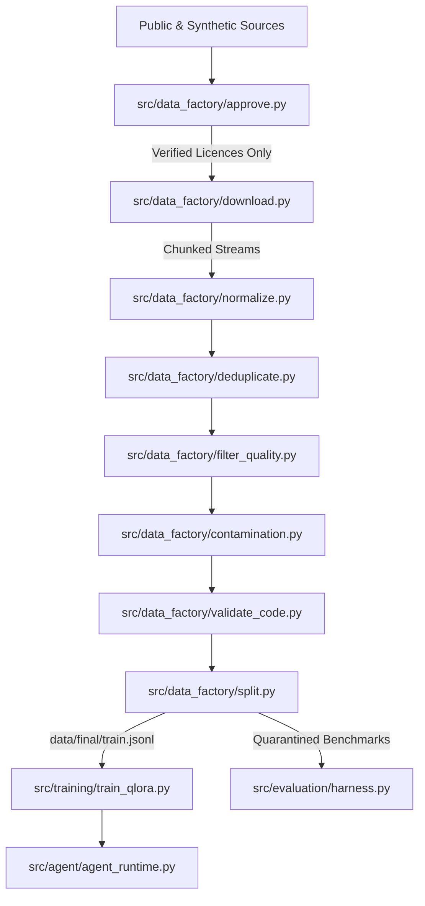

# AetherCoder-27B: LLM Data Factory & Coding Agent Platform

A reproducible, high-throughput data engineering and training ecosystem designed for training **AetherCoder-27B**, inspired by the code-reasoning capabilities of `Qwen/Qwen3.8-27B` and community fine-tunes (`DavidAU/Qwen3.8-27B-TURBO-...`).

---

## 1. System Architecture



---

## 2. Hardware Constraints & Environment

- **Detected OS**: Windows 11 Home Single Language (64-bit)
- **Detected GPU**: NVIDIA GeForce RTX 3050 Laptop GPU (6 GB VRAM)
- **Detected RAM**: 24 GB DDR4
- **Free Disk Space**: 45.45 GB (with an enforced **15 GB safety stop**)
- **Target Model Architecture**: 27B Parameters (Requires 24–80 GB VRAM for full fine-tuning; validated locally on 1.5B pilot with cloud deployment scripts provided for 27B).

---

## 3. Quick Start & Execution Guide

### Step 1: Run Automated Test Suite
Execute the unit and integration tests covering the complete pipeline:
```powershell
python -m pytest tests/
```

### Step 2: Run End-to-End Large-Scale Data Factory
Execute all data engineering phases (discovery, approval, download, normalization, deduplication, quality filtering, contamination check, AST validation, and partitioning):
```powershell
python scripts/run_pipeline.py
```

### Step 3: Run Pilot QLoRA Fine-Tuning Check
Verify tokenizer chat template formatting and QLoRA pipeline configuration:
```powershell
python -m src.training.train_qlora --dry-run
```

### Step 4: Run Held-Out Evaluation Suite
Execute the sandbox unit test evaluation harness:
```powershell
python -m src.evaluation.harness
```

### Step 5: Test the Autonomous Coding Agent
Run the agent tool-use execution loop:
```powershell
python -m src.agent.agent_runtime --task "Inspect codebase and verify pipeline integrity"
```

### Step 6: Production 27B Scaling (Cloud A100/H100)
Launch distributed training across GPU clusters:
```bash
bash scripts/run_27b_cloud.sh
```

---

## 4. Dataset Catalogue & Governance

- [datasets.json](file:///data/catalogue/datasets.json): Machine-readable metadata catalog of audited sources.
- [DATA_SOURCES.csv](file:///data/catalogue/DATA_SOURCES.csv): Tabular view of revisions, licenses, and roles.
- [LICENCE_AUDIT.md](file:///data/catalogue/LICENCE_AUDIT.md): Detailed legal and permissive license compliance review.
- [REJECTED_SOURCES.md](file:///data/catalogue/REJECTED_SOURCES.md): Log of rejected (e.g. CodeSearchNet) and quarantined benchmark sources.
- [DATA_CARD.md](file:///data/catalogue/DATA_CARD.md): Formal dataset card specifying schemas, languages, and task taxonomy.
- [CORPUS_REPORT.md](file:///data/catalogue/CORPUS_REPORT.md): Statistics and token estimates for final training splits.

---

## 5. Multi-Language & Multi-Task Coverage

AetherCoder's dataset is balanced across:
- **Languages**: Python, Java, C, C++, JavaScript, TypeScript, SQL, HTML, CSS, Rust, Go, Bash.
- **Tasks**: Code Generation, Debugging & Bug Repair, Unit Test Generation, Code Review, Agent Tool Use, and Tamil-English Technical Explanations.
# coding-agent-dataset-test-1
