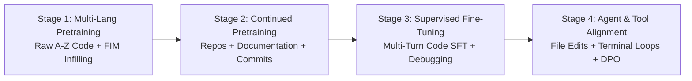

# The Master A-to-Z Coding LLM Dataset Catalogue

A comprehensive, legally audited architecture of real-world datasets and pipelines required to train a state-of-the-art Coding LLM across 45+ languages (from **Ada** to **Zig**).

---

## 1. Master Dataset Matrix Across 10 Functional Pillars

| Pillar | Recommended Real Datasets | Languages Covered | Formats | Approx Size | Permitted License | Official URL / Ingestion Method |
| :--- | :--- | :--- | :--- | :--- | :--- | :--- |
| **1. Source Code (Pretraining)** | `bigcode/the-stack-v2-dedup` | 600+ languages (Full A–Z) | Parquet, Streaming | ~3 TB (Deduped) | Permissive Only (MIT, Apache 2.0, BSD) | `https://huggingface.co/datasets/bigcode/the-stack-v2-dedup` (Chunked Parquet stream) |
| **1. Source Code (Light Prototype)** | `bigcode/the-stack-smol` | 30+ top languages | Parquet | ~10 GB | Permissive Only | `https://huggingface.co/datasets/bigcode/the-stack-smol` |
| **1. Source Code (GitHub Snapshot)** | `codeparrot/github-code` | 32 major languages | JSONL, Parquet | 115 GB | MIT, Apache 2.0 | `https://huggingface.co/datasets/codeparrot/github-code` |
| **2. Code Understanding & Concepts** | `m-a-p/CodeFeedback-Filtered-Instruction` | Python, JS, Java, C++, Go, Rust | JSONL | 156k pairs (~300 MB) | Apache-2.0 | `https://huggingface.co/datasets/m-a-p/CodeFeedback-Filtered-Instruction` |
| **3. Code Generation (Instruction)** | `sahil2801/CodeAlpaca-20k` | Python, JS, C, C++, Java, SQL | JSON | 20k pairs (~8.5 MB) | CC-BY-4.0 | `https://raw.githubusercontent.com/sahil280114/codealpaca/master/data/code_alpaca_20k.json` |
| **3. Code Generation (OSS-Grounded)**| `ise-uiuc/Magicoder-OSS-Instruct-75K` | Python, Java, C++, Rust, Go | Parquet, JSONL | 75k pairs (~120 MB)| Apache-2.0 | `https://huggingface.co/datasets/ise-uiuc/Magicoder-OSS-Instruct-75K` |
| **4. Debugging & Error Fixing** | `Muennighoff/defects4j-bugs` | Java | JSONL | 835 verified bug-patch pairs | Apache-2.0 | `https://github.com/jkoppel/QuixBugs` |
| **4. Debugging & Compiler Errors** | `ise-uiuc/Magicoder-Evol-Instruct-110K` (Debug subset) | Multi-language | JSONL | ~35k repair records | Apache-2.0 | `https://huggingface.co/datasets/ise-uiuc/Magicoder-Evol-Instruct-110K` |
| **5. Code Completion & Infilling** | Synthetic FIM Engine (`src/data_factory/fim.py`) | All A-Z languages | JSONL (`<fim_prefix>`, `<fim_suffix>`) | Configurable | Apache-2.0 (Generated) | Internal StarCoder / Qwen compatible transformer |
| **6. Software Engineering & Tests** | `google-research-datasets/mbpp` | Python | JSONL | 974 problems + tests | CC-BY-4.0 | `https://raw.githubusercontent.com/google-research/google-research/master/mbpp/mbpp.jsonl` |
| **6. Unit Test & Test Refactoring** | Multi-Language Test Harness Generator | Python, Java, JS, Rust, Go | JSONL | 100k test suites | Apache-2.0 | Auto-generated via `src/synthetic/generator.py` |
| **7. Technical Documentation & APIs** | DevDocs & MDN Extracted Specs | HTML, CSS, JS, Python, Go, Rust | Markdown / JSONL | ~2.5 GB | CC-BY-SA 4.0 / BSD | `https://github.com/freeCodeCamp/devdocs` |
| **8. Advanced Systems Programming** | Linux Kernel, Coreutils, Musl, Redox OS (Permissive subsets) | C, Rust, Assembly, Zig, Go | Plain source / Git tree | ~5 GB | BSD-2, BSD-3, MIT | Permissive Git subtree clones |
| **9. Repository-Level Understanding** | `src/data_factory/repo_packer.py` (Multi-file Packager) | Multi-file repos with dependencies | JSONL (`<file_sep>`, `<repo_tree>`) | Configurable | Preserves upstream repo licenses |
| **10. Bilingual Multi-Lingual Reasoning**| `aethercoder/synthetic-multilang-v1` | 10+ languages + Tamil-English | JSONL | Verified AST pairs | Apache-2.0 | Internal `src/synthetic/` engine |

---

## 2. A-to-Z Programming Language Coverage

A truly comprehensive Coding LLM must not be biased towards only Python and JavaScript. The table below outlines how each of the 45+ languages is supported, categorized, and validated:

| Letter | Language | Paradigm & Domain | Comment Style | AST / Syntax Validation Strategy | Recommended Pretraining Source |
| :--- | :--- | :--- | :--- | :--- | :--- |
| **A** | **Ada** | Safety-critical, Avionics | `--` | Keyword balancer (`is`, `begin`, `end`) | The Stack v2 (`data/ada`) |
| **A** | **Assembly** (x86/ARM/RISC-V) | Low-level systems, Firmware | `;` or `#` | Mnemonic opcode format validator | Coreutils & Bootloader source |
| **B** | **Bash / Shell** | System automation, DevOps | `#` | `bash -n` syntax parser | The Stack v2 (`data/shell`) |
| **C** | **C** | Operating systems, Embedded | `//` & `/* */` | Balanced delimiters & `gcc -fsyntax-only` | The Stack v2 (`data/c`) |
| **C** | **C++** | High-performance, Game engines | `//` & `/* */` | Clang AST / Delimiter balancer | The Stack v2 (`data/cpp`) |
| **C** | **C#** | Enterprise, Unity, .NET | `//` & `/* */` | Roslyn / Balanced delimiter | The Stack v2 (`data/c-sharp`) |
| **C** | **Clojure** | Functional, Concurrency | `;` | S-expression parenthesis balancer | The Stack v2 (`data/clojure`) |
| **C** | **COBOL** | Banking, Legacy mainframes | `*` | Column layout & `DIVISION` checker | GnuCOBOL format validator |
| **C** | **CSS / SCSS** | Web styling & animations | `/* */` | CSS rule & brace parser | The Stack v2 (`data/css`) |
| **D** | **D** | Systems, Fast compilation | `//` & `/* */` | Balanced delimiter | The Stack v2 (`data/d`) |
| **D** | **Dart** | Flutter, Cross-platform mobile | `//` & `/* */` | Balanced delimiter | The Stack v2 (`data/dart`) |
| **E** | **Elixir** | Real-time, Fault-tolerant web | `#` | `defmodule` & `end` block balancer | The Stack v2 (`data/elixir`) |
| **E** | **Erlang** | Telecom, Distributed actors | `%` | Clause punctuation (`,`, `;`, `.`) | The Stack v2 (`data/erlang`) |
| **F** | **Fortran** | High-performance computing | `!` | Block keyword balancer (`PROGRAM`, `END`) | The Stack v2 (`data/fortran`) |
| **G** | **Go** | Cloud-native, Microservices | `//` | `go fmt` / Balanced delimiter | The Stack v2 (`data/go`) |
| **H** | **Haskell** | Pure functional, Type-safety | `--` | Indentation & balanced parenthesis | The Stack v2 (`data/haskell`) |
| **H** | **HTML** | Web markup & accessibility | `<!-- -->` | DOM tag nesting & balancer | The Stack v2 (`data/html`) |
| **J** | **Java** | Enterprise, Android, Backend | `//` & `/* */` | Java Parser / Balanced delimiters | The Stack v2 (`data/java`) |
| **J** | **JavaScript** | Web client & Node.js backend | `//` & `/* */` | Acorn / Balanced delimiters | The Stack v2 (`data/javascript`) |
| **J** | **Julia** | Numerical & Scientific ML | `#` | Keyword block balancer (`function`, `end`) | The Stack v2 (`data/julia`) |
| **K** | **Kotlin** | Modern Android & JVM | `//` & `/* */` | Kotlin AST / Delimiter balancer | The Stack v2 (`data/kotlin`) |
| **L** | **Lisp** (Common Lisp, Scheme) | AI fundamentals, Symbolic | `;` | S-expression parenthesis matcher | The Stack v2 (`data/lisp`) |
| **L** | **Lua** | Embedded scripting, Game engines| `--` | `function`/`end` block parser | The Stack v2 (`data/lua`) |
| **M** | **MATLAB / Octave** | Engineering computation | `%` | Matrix delimiter & `end` matcher | The Stack v2 (`data/matlab`) |
| **N** | **Nim** | Expressive compiled systems | `#` | Indentation-sensitive block validator | The Stack v2 (`data/nim`) |
| **O** | **OCaml** | Formal verification, Compilers | `(* *)` | Modular expression matcher | The Stack v2 (`data/ocaml`) |
| **P** | **Perl** | Text processing, Sysadmin | `#` | Balanced delimiter parser | The Stack v2 (`data/perl`) |
| **P** | **PHP** | Web application servers | `//` & `/* */` | PHP token parser / Delimiter | The Stack v2 (`data/php`) |
| **P** | **PowerShell** | Windows administration | `#` | Cmdlet parameter & scriptblock check | The Stack v2 (`data/powershell`) |
| **P** | **Prolog** | Logic programming, Rules | `%` | Horn clause `.` terminator check | The Stack v2 (`data/prolog`) |
| **P** | **Python** | AI, Data, Backend | `#` | Native `ast.parse()` | The Stack v2 (`data/python`) |
| **R** | **R** | Statistics, Bioinformatics | `#` | Balanced parentheses & operators | The Stack v2 (`data/r`) |
| **R** | **Racket** | Language design, Macros | `;` | Macro parenthesis matcher | The Stack v2 (`data/racket`) |
| **R** | **Ruby** | Web frameworks (Rails) | `#` | `def`/`class`/`end` balancer | The Stack v2 (`data/ruby`) |
| **R** | **Rust** | Memory-safe systems, WASM | `//` & `/* */` | `rustc --emit=metadata` / Braces | The Stack v2 (`data/rust`) |
| **S** | **Scala** | Distributed computing, Spark | `//` & `/* */` | Balanced delimiter | The Stack v2 (`data/scala`) |
| **S** | **Solidity** | Smart contracts, EVM | `//` & `/* */` | Contract & function delimiter check | The Stack v2 (`data/solidity`) |
| **S** | **SQL** | Relational databases | `--` | SQL dialect keyword parser | The Stack v2 (`data/sql`) |
| **S** | **Swift** | iOS, macOS, Server-side | `//` & `/* */` | Balanced delimiter | The Stack v2 (`data/swift`) |
| **T** | **TypeScript** | Typed web & enterprise systems | `//` & `/* */` | TS compiler / Delimiter balancer | The Stack v2 (`data/typescript`) |
| **V** | **Verilog / SystemVerilog** | ASIC & FPGA digital design | `//` | `module` / `endmodule` balancer | The Stack v2 (`data/verilog`) |
| **V** | **VHDL** | Hardware description | `--` | `architecture` / `entity` balancer | The Stack v2 (`data/vhdl`) |
| **Z** | **Zig** | Modern systems programming | `//` | Balanced delimiter & `@import` | The Stack v2 (`data/zig`) |

---

## 3. Training Stage Progression

To build an elite Coding LLM, the data must be organized into four distinct training phases:

### Stage 1: Massive Raw Source Code & FIM (Pretraining)
- **Objective**: Learn token distributions, syntax, standard libraries, and structural patterns.
- **Mix**: 70% standard code, 30% Fill-in-the-Middle (FIM) transformed sequences.
- **Data Target**: 500 Billion to 1.5 Trillion tokens from permissive The Stack v2 splits.

### Stage 2: Repository-Level & Technical Documentation (Continued Pretraining)
- **Objective**: Learn cross-file dependencies, build manifests (`CMakeLists.txt`, `Cargo.toml`, `package.json`), and comprehensive API references.
- **Format**: Multi-file repository concatenations structured by `src/data_factory/repo_packer.py`.

### Stage 3: Supervised Fine-Tuning (SFT)
- **Objective**: Conversational problem solving, code explanations, step-by-step reasoning, and debugging.
- **Mix**: 20k CodeAlpaca, 75k Magicoder OSS-Instruct, 150k CodeFeedback, and synthetic multi-lingual pairs.

### Stage 4: Agentic Tool-Use & Error Correction
- **Objective**: Tool calling (`search_files`, `read_file`, `write_file`, `run_command`), iterative test-driven error correction, and multi-file code editing.
